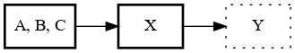
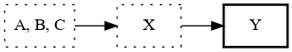
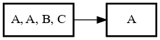

# Mock Printer Mode

Test cases in mock printer mode are built from
[control flow Protobufs](./proto/control_flow.proto). The appendices
in this documentation provide some examples of their mechanics.

Much of this document intermingles usage and maintenance notes. Casual
users need not read this document in detail: try reading an existing
test first and following it by example. Return to this document if you
seek greater depth.

*** aside
TODO(b/178649877): document the command-line flag that will cause
`virtual-usb-printer` to enter mock printer mode.
***

*** aside
TODO(b/178649877): document the general usage of mock printer mode.
***

## Terminology

*   *Test case* - a series of steps that verify at least (and hopefully
    at most) one particular behavior of the Chromium OS printing stack.
*   *Test case step* - a cluster of expectations and at most one
    response. In prose, "`virtual-usb-printer` expects some of events A,
    B, and C; when the expectation is met, `virtual-usb-printer`
    responds with response D."
*   *Matcher* - an expression that defines how an expectation is met.
    For example, "Expectation X is met when `virtual-usb-printer`
    receives message with contents A, B, and C."

*** promo
Mock printer mode will only support building matchers for IPP messages
in the near term.
***

Test case steps (`TestCaseStep`s) have some additional associated terms:

*   *Progression* - a test case step makes _progress_ when
    `virtual-usb-printer` receives a message that matches some
    expectation of said step. `virtual-usb-printer` marks the particular
    expectation as met, thereby progressing the test case step.
*   *Fulfillment* - a test case step is _fulfilled_ when
    `virtual-usb-printer` has received enough messages s.t. said step
    could be considered complete.
*   *Saturation* - a test case step is _saturated_ when
    `virtual-usb-printer` cannot match any more expectations against it
    without exceeding the specified `Cardinality::Count`; the test case
    step is forbidden from progressing further.
*   *Reachable* - a test case step is _reachable_ when it is eligible
    for progression. For example, the "current" test case step is always
    trivially reachable.

*** aside
Fulfillment and saturation are always synonymous when the test case step
has `Cardinality::Type::{ALL_IN_ORDER,ALL_IN_ANY_ORDER}`: _all_ given
expectations must be met, fulfilling and saturating the step
simultaneously. They can diverge for
`Cardinality::Type::{SOME_OF,REPEATED}`, depending on the associated
`Cardinality::Count`.
***

## Source Code Layout

*   `proto/` - defines Protobuf representations of test cases: control
    flow, matchers, and responses.
*   `ipp_matching_validation.h` - used to verify that the IPP
    message Protobufs used as matchers are well-formed.
*   `ipp_matching.h` - used to match `mocking::IppMessage` Protobufs
    with incoming `ipp::Request` messages (received by libipp).

## Appendix: TestCase Flow

`virtual-usb-printer` takes a `TestCase` and reads out the sequence of
`TestCaseStep`s. `virtual-usb-printer` maintains

*   The current test case step. This is the oldest step that is not
    saturated (though it might be fulfilled).
*   Some number of reachable test case steps. Excluding the
    always-reachable current test case step, there may be zero or more
    future test case steps that are also reachable. This is determined
    by the `Cardinality` of each test case step.

### Basic Reachability Example

Given a `TestCase`:

```none
steps {
  cardinality {
    type: SOME_OF
    count { at_most: 3 }
  }
  expectation_with_response { # A }
  expectation_with_response { # B }
  expectation_with_response { # C }
}
steps {
  cardinality {
    type: ALL_IN_ORDER
  }
  expectation_with_response { # X }
}
steps {
  cardinality {
    type: ALL_IN_ORDER
  }
  expectation_with_response { # Y }
}
```

Then the starting state of the test case in `virtual-usb-printer` looks
like this:



*   The _current_ step is the first one (`A`, `B`, or `C`).
*   The second step (expecting `X`) is reachable.
*   The third step (expecting `Y`) is _not_ reachable.

If `virtual-usb-printer` then receives a message matching `X`, then

*   The second step (expecting `X`) would match and be progressed.
*   The second step would be both fulfilled and saturated.
*   The current step would change to be the third (expecting `Y`).



### Reachability Example: Laziness

`virtual-usb-printer` takes a lazy approach to progressing test case
steps. It will always try to progress the oldest non-saturated test case
step (starting with the current one), even if other reachable steps may
match.

Given a `TestCase`:

```none
steps {
  cardinality {
    type: SOME_OF
    count { at_most: 3 }
  }
  expectation_with_response { # A }
  expectation_with_response { # A }
  expectation_with_response { # B }
  expectation_with_response { # C }
}
steps {
  cardinality {
    type: ALL_IN_ORDER
  }
  expectation_with_response { # A }
}
```

Then the starting state of the test case in `virtual-usb-printer` looks
like this:



Although step two is _reachable_, `virtual-usb-printer` will only
progress it if

*   either step 1 saturates (e.g. `B, A, C` arrive in succession) or
*   three `A` messages arrive in succession, _not_ saturating step 1,
    but making the second step the only reachable matcher that can
    accept an `A` message.

## Appendix: TestCaseStep with multiple Expectations

Each `TestCaseStep` associates a `Cardinality` with a set of
`ExpectationWithResponse`s. `virtual-usb-printer` matches incoming
messages greedily, so test authors must structure their matchers
carefully.

### Matcher order matters

***promo
Using `Cardinality::Type::REPEATED` constrains the test author to
providing exactly one `ExpectationWithResponse` in the `TestCaseStep`.
The fields in `Cardinality::Count` then provide upper, lower, or exact
bounds on how many times the contained `Expectation` must be fulfilled.
***

When processing a `TestCaseStep` with multiple
`ExpectationWithResponse`s and `Cardinality::Type::ALL_IN_ANY_ORDER` or
`Cardinality::Type::SOME_OF`, `virtual-usb-printer` will react to each
incoming message by looking for the first matching
`ExpectationWithResponse` and mark it as fulfilled.

Suppose you have a `TestCaseStep`:

```none
cardinality {
  type: SOME_OF
  count { exactly: 3 }
}
expectation_with_response { expectation { # "expectation 1"
  # match A, B, or C
} }
expectation_with_response { expectation { # "expectation 2"
  # match B
} }
expectation_with_response { expectation { # "expectation 3"
  # match X
} }
expectation_with_response { expectation { # "expectation 4"
  # match Y
} }
```

Suppose that `virtual-usb-printer` then receives the following messages:

1.  Message `X`. This matches expectation 3, which is removed from
    consideration for future matches. 1 match of 3 total is fulfilled.
1.  Message `B`. This matches _both_ expectation 1 and expectation 2.
    `virtual-usb-printer` greedily uses the first reachable expectation
    and removes expectation 1 from consideration for future matches. 2
    matches of 3 total are fulfilled.
1.  Message `C`. This _would_ match expectation 1, but it was stricken
    from consideration by the previous match. No other expectations
    in this `TestCaseStep` match message `C`.
1.  This `TestCaseStep` did not reach the prescribed `Cardinality`,
    so it is unfulfilled. The `TestCase` fails.

*** aside
The sequence of messages above would also fail given
`Type::ALL_IN_ANY_ORDER`, which would demand that all four expectations
be fulfilled; the matching process follows the same rules.
***

### TestCaseSteps with fuzzy Cardinality::Count

When processing a `TestCaseStep` with `Cardinality::Type::SOME_OF`,
test writers must provide `Cardinality::Count`. When the `Count` is
fuzzy (e.g. specifies `at_least` and `at_most`, not `exactly`),
`virtual-usb-printer` still takes a greedy match approach to determining
when a `TestCaseStep` is complete.

Suppose you have a `TestCaseStep`:

```none
cardinality {
  type: SOME_OF
  count {
    at_least: 2
    at_most: 4
  }
}
expectation_with_response { expectation { # "expectation 1"
  # match A, B, or C
} }
expectation_with_response { expectation { # "expectation 2"
  # match B
} }
expectation_with_response { expectation { # "expectation 3"
  # match X
} }
expectation_with_response { expectation { # "expectation 4"
  # match Y
} }
```

Suppose that `virtual-usb-printer` then receives the following messages:

1.  Message `Y`. This matches expectation 4, which is removed from
    consideration for future matches. We have 1 match now.
2.  Message `C`. This matches expectation 1, which is removed from
    consideration for future matches. We have 2 matches now. Since
    this would satisfy `Cardinality::Count::at_least == 2`, this current
    `TestCaseStep` is tentatively fulfilled; `virtual-usb-printer` is
    _free to_ move onto the next `TestCaseStep`, but will continue
    running out the current `TestcaseStep` if more matching messages
    arrive.

Consider this possibility for the next inbound messages:

3.  Message `B`. This matches expectation 2, which is removed from
    consideration for future matches. We have 3 matches now. This
    still satisfies the bounds provided by the `Cardinality` and the
    present `TestCaseStep` is still tentatively fulfilled.
4.  Message `Z`. This matches none of the expectations in the present
    `TestCaseStep`, so `virtual-usb-printer` finalizes the tentative
    fulfillment of this `TestCaseStep` and seeks out a matcher in the
    following `TestCaseStep`.

Consider this alternate possibility for the next inbound messages:

3.  Message `Z`. Same as step 4 in the previous scenario; this
    `TestCaseStep` graduates from tentative fulfillment (2 total
    matches) and `virtual-usb-printer` seeks out a match in the
    following `TestCaseStep`.
