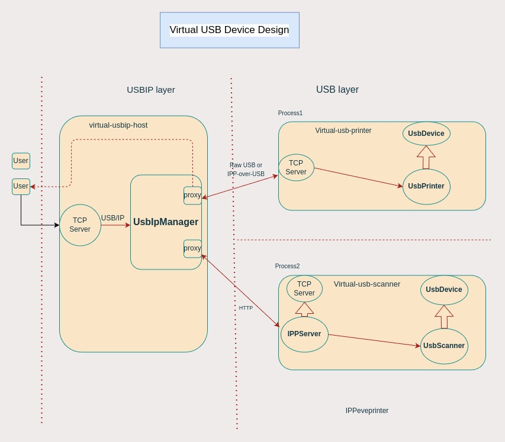

# Virtual USB Device

`virtual-usb-device` is a framework to emulate any usb device in software mode. As of now,
usb printer is emulated using this framework. New usb devices can be emulated by provding device specific implementation.

## Motivation

Before, there was single `virtual-usb-printer` component which emulated usb printer
using USB/IP and IPP-over-USB protocol. The older design was monolithic, non-scalable, inflexible with the newer requirement. This motivated to create new framework virtual-usb-device,
so that newer usb devices could also be emulated using this framework.

## How it works

Virtual usb devices can be attached to system using USB/IP protocol. Once attached, devices act as if it were physically connected to a USB port and thus all USB access are seamless.

## Design

The virtual-usb-device is multi-process framework. It has single `USBIP Host` process and at least one `USB device` process.

<b> USBIP host process:</b>
It provide a server which listens for USB/IP messages and allow usb devices to be attached. It also parses usbip messages, strip actual usb command and pass it to device process.

<b> USB device process: </b>
It provides a server which listen of any USB request sent by `USBIP Host` process, take action as per request and responds back to the `USBIP host`. There are one process for each usb device. Once started, it registers device information with `USBIP host` and deregister itself on termination.

[Application] <-- USB/IP --> [USBIP Host process] <--USB requests--> [USB device process]



## Virtual USB Printer
As of now, only usb printer implementation is available.
It supports both regular USB printers as well as IPP-over-USB devices.

## Installation

If for some reason you need to build it yourself, you can `USE=usbip`
when building packages for your board - i.e.

```
USE="usbip" ./build_packages --board=$BOARD
```

## Developer guide:

*** note
`virtual-usb-printer` relies on `usbip` to manifest as a virtual USB device.
Most test images seem to come with this built-in by default. If you need
to build your own kernel with `usbip` support, make sure to build with
`CONFIG_USBIP_CORE` and `CONFIG_USBIP_VHCI_HCD`.
***

##Command to build locally and deploy:

In development environment:
```
cros_sdk cros_workon_make --board=$BOARD  virtual-usb-printer --install

// Launch vm:
cros vm --start --board=$BOARD --image-path=./src/build/images/amd64-generic/R119-15614.0.0-d2023_11_02_202120-a1/chromiumos_test_image.bin

// deploy into vm
cros deploy localhost:9222 virtual-usb-printer
```

In VM:

```
// Load vhci_hcd kernel module
amd64-generic ~ # modprobe vhci_hcd

// RUN usbip host
amd64-generic ~ # /usr/local/bin/virtual-usbip-host --port=3240 &

// Device 1 : RUN printer with port 3241
amd64-generic ~ # /usr/local/bin/virtual-printer --descriptors_path=/usr/local/etc/virtual-usb-printer/usb_printer.json  --record_doc_path=/tmp  --host_port=3240 --port=3241 &

// Device 2 : RUN IPP printer with port 3242
amd64-generic ~ # /usr/local/bin/virtual-printer --descriptors_path=/usr/local/etc/virtual-usb-printer/usb_printer.json  ----attributes_path=/usr/local/etc/virtual-usb-printer/ipp_attributes.json--record_doc_path=/tmp  --host_port=3240 --port=3242 &

```

// Run usbip commands

```
amd64-generic ~ # usbip list -r 127.0.0.1
amd64-generic ~ # usbip attach -r 127.0.0.1 -b 1-7

amd64-generic ~ # lsusb
    > Bus 003 Device 001: ID 1d6b:0003 Linux Foundation 3.0 root hub
      Bus 002 Device 013: ID 18d1:505e Google Inc. Virtual USB Printer
      Bus 002 Device 012: ID 18d1:505e Google Inc. Virtual USB Printer
      Bus 002 Device 001: ID 1d6b:0002 Linux Foundation 2.0 root hub

amd64-generic ~ # usbip port
      Imported USB devices
      ====================
      Port 00: <Port in Use> at High Speed(480Mbps)
            unknown vendor : unknown product (18d1:505e)
                    2-1 -> usbip://127.0.0.1:3240/1-1
                               -> remote bus/dev 001/001

amd64-generic ~ # usbip detach -p 00  // port number taken from `usbip port` output
      usbip: info: Port 0 is now detached!

```

*** promo
`virtual-usb-printer` can behave like
*   a printer,
*   an eSCL scanner, or
*   a [scriptable mock printer](./mock_printer/README.md).
***

## Configuration

The printer's USB descriptors and defined IPP attributes can be configured using
a JSON file and are loaded at run-time using command line flags. Example
configurations can be found in the `config/` directory.

The configuration files can be loaded with the following flags:

+ `--descriptors_path` - full path to the JSON file which defines the USB
  descriptors
+ `--attributes_path` - full path to the JSON file which defines the supported
  IPP attributes
  + Only needed for IPP-over-USB printer configurations
+ `--record_doc_path` - full path to the file used to record documents received
  from print jobs
+ `--output_log_dir` - directory path specifying where scan settings will be logged

## Using in Tast

Exisitng tast test can be run as before :
```
tast run 127.0.0.1:9222 printer.PrintUSB
tast run 127.0.0.1:9222 printer.*
tast run 127.0.0.1:9222 scanner.*
```
TODO: Tast printing need to patched up for above command to work with newer virtual usb printer. Basically we also want tast test to automatically choose (based on runtime flag) newer or oder version of virtual usb printer.

### Print Tests

+ [printer.AddUSBPrinter](https://source.chromium.org/chromiumos/chromiumos/codesearch/+/main:src/platform/tast-tests/src/chromiumos/tast/local/bundles/cros/printer/add_usb_printer.go)
  + Tests that adding a basic USB printer works correctly
+ [printer.PrintUSB](https://source.chromium.org/chromiumos/chromiumos/codesearch/+/main:src/platform/tast-tests/src/chromiumos/tast/local/bundles/cros/printer/print_usb.go)
  + Tests that the full print pipeline works correctly for a basic USB printer
+ [printer.PrintIPPUSB](https://source.chromium.org/chromiumos/chromiumos/codesearch/+/main:src/platform/tast-tests/src/chromiumos/tast/local/bundles/cros/printer/print_ippusb.go)
  + Tests that the full print pipeline for IPP-over-USB printing works correctly
  + This also tests that the [automatic\_usb\_printer\_configurer](https://source.chromium.org/chromium/chromium/src/+/main:chrome/browser/chromeos/printing/automatic_usb_printer_configurer.h) is able to automatically configure an IPP Everywhere printer
+ [printer.IPPUSBPPDNoCopies](https://source.chromium.org/chromiumos/chromiumos/codesearch/+/main:src/platform/tast-tests/src/chromiumos/tast/local/bundles/cros/printer/ippusb_ppd_no_copies.go),
  [printer.IPPUSBPPDCopiesUnsupported](https://source.chromium.org/chromiumos/chromiumos/codesearch/+/main:src/platform/tast-tests/src/chromiumos/tast/local/bundles/cros/printer/ippusb_ppd_copies_unsupported.go),
  and
  [printer.IPPUSBPPDCopiesSupported](https://source.chromium.org/chromiumos/chromiumos/codesearch/+/main:src/platform/tast-tests/src/chromiumos/tast/local/bundles/cros/printer/ippusb_ppd_copies_supported.go)
  + Tests that the CUPS understands whether or not printers support
    print job copies (duplication).

### Scan Tests

+ [documentscanapi.Scan](https://source.chromium.org/chromiumos/chromiumos/codesearch/+/main:src/platform/tast-tests/src/chromiumos/tast/local/bundles/cros/documentscanapi/scan.go)
  + Tests the document scanner app.
+ [scanner.EnumerateIPPUSB](https://source.chromium.org/chromiumos/chromiumos/codesearch/+/main:src/platform/tast-tests/src/chromiumos/tast/local/bundles/cros/scanner/enumerate_ipp_usb.go)
  + Tests that
    [lorgnette](https://source.chromium.org/chromiumos/chromiumos/codesearch/+/main:src/platform2/lorgnette/)
    can correctly enumerate IPP USB devices.
+ [scanner.ScanESCLIPP](https://source.chromium.org/chromiumos/chromiumos/codesearch/+/main:src/platform/tast-tests/src/chromiumos/tast/local/bundles/cros/scanner/scan_escl_ipp.go)
  + Tests basic scanning functionality via IPP USB.
